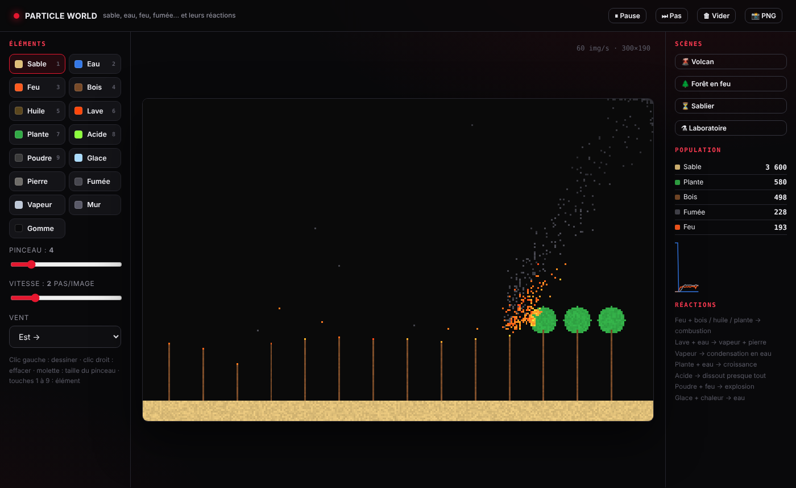
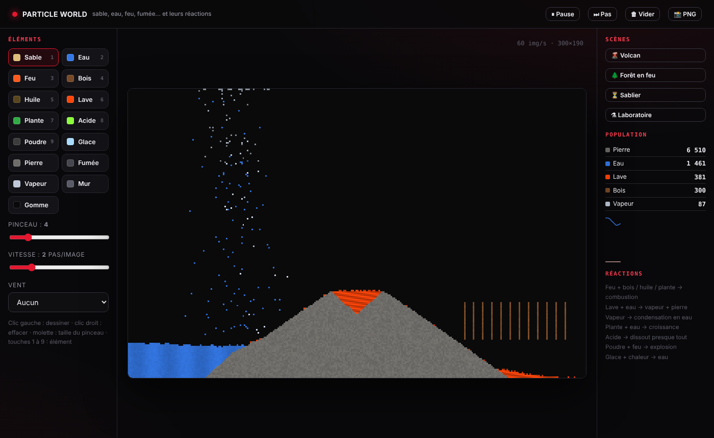

# 🔥 Particle World

> Simulation interactive où le sable, l'eau, le feu, la fumée et une dizaine d'autres éléments interagissent selon des règles physiques simples.

**▶ Jouable dans le navigateur (GitHub Pages).**




## 15 éléments, de nombreuses réactions
| Famille | Éléments | Comportement |
|---|---|---|
| Poudres | sable, pierre, poudre | tombent et s'empilent en cônes, coulent dans les liquides moins denses |
| Liquides | eau, huile, acide, lave | s'écoulent et s'étalent ; ils se superposent par **densité** (l'huile flotte sur l'eau) |
| Gaz | feu, fumée, vapeur | montent, dérivent avec le vent, ont une durée de vie |
| Solides | mur, bois, plante, glace | statiques, mais réactifs |

Réactions : combustion (bois, huile, plante), le feu reste « collé » au combustible tant qu'il en reste, la **lave transforme l'eau en vapeur** et se fige en pierre, la vapeur se condense, les plantes poussent dans l'eau, l'**acide** dissout presque tout, la **poudre explose** en chaîne, la glace fond à la chaleur.

## Interface
- Palette d'éléments (touches 1 à 9), pinceau réglable (molette), clic droit pour effacer, tracé continu sans trous.
- Pause, avancer d'un pas, vitesse, **vent**, export PNG ×4.
- 4 scènes prêtes : volcan, forêt en feu, sablier, laboratoire (glace, huile enflammée, poudre et acide).
- Population de chaque élément et courbe feu / eau / fumée en direct.

## Moteur (`sim.js`)
Automate cellulaire sur une grille de 300 × 190 (`Uint8Array`) :
- parcours de **bas en haut** avec une direction horizontale alternée à chaque pas, ce qui évite les biais gauche/droite ;
- drapeau `moved` pour qu'une particule ne bouge qu'une fois par pas ;
- tableau `life` pour la durée de vie du feu, de la fumée et de la vapeur ;
- générateur *xorshift* à graine : simulations reproductibles.

Rendu : `ImageData` écrit pixel par pixel, bruit de couleur figé par cellule, scintillement du feu, ondulation de l'eau, lueur de la lave, mise à l'échelle *pixelated*.

```bash
npm test   # conservation de la masse, étalement de l'eau, combustion, lave + eau, explosion
```

## Licence
MIT © Jimo0x
